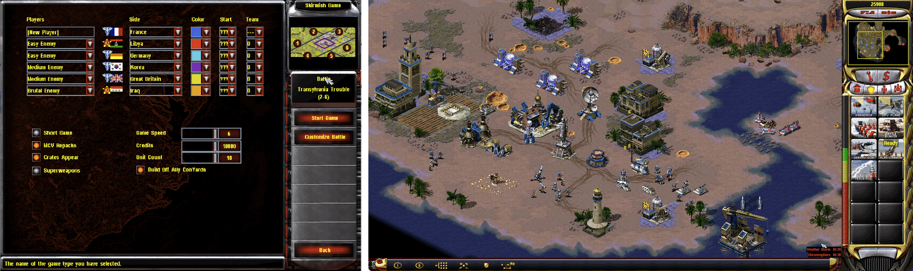

<p align="center" dir="ltr">
  <a href="README.sv.md" lang="sv">Svenska</a> · <a href="README.zh-CN.md" lang="zh-CN">简体中文</a> · <a href="README.de.md" lang="de">Deutsch</a> · <a href="README.ar.md" lang="ar" dir="rtl">العربية</a> · <a href="README.ru.md" lang="ru">Русский</a> · <a href="README.th.md" lang="th">ไทย</a> · <a href="README.tr.md" lang="tr">Türkçe</a> · <strong>English</strong>
  &nbsp;&nbsp;
  <a href="https://github.com/YuriPlanet/vera20k/actions/workflows/macos.yml?query=branch%3Amain" title="Latest macOS library test run (run manually)"></a>
  <a href="https://github.com/YuriPlanet/vera20k/actions/workflows/linux.yml?query=branch%3Amain" title="Latest Linux library test run (run manually)"></a>
  <a href="https://github.com/YuriPlanet/vera20k/actions/workflows/windows.yml?query=branch%3Amain" title="Latest Windows library test run (run manually)"></a>
  <a href="https://discord.gg/kmjRUn5m5F"></a>
  
</p>

<!-- Keep all translated READMEs in sync when changing the text below. -->

# VERA20K

VERA20K is a community-led rewrite of the original engine, `gamemd.exe`. It uses the original
game files, so you'll need your own copy of Red Alert 2: Yuri's Revenge.

VERA20K is made by gamers, for gamers, and gamers have the final say in where it goes.



## Project goals

1. Keep the gameplay, visuals and atmosphere of the original Red Alert 2: Yuri's Revenge.
2. Support bigger battles: up to **30 players** and **20,000 units** on 500×500 maps.
3. Incorporate known RTS features and some never seen before.
4. Integrated multiplayer client

## Current status

**In active development.**

- **Skirmish:** Playable on Windows, Linux and macOS, with original and random maps,
  base building, harvesting, combat and save/load.
- **Campaigns:** Missions can launch; support remains incomplete.
- **AI:** Parts of the original AI handle base building and scripted attacks.
- **Ongoing work:** Gameplay accuracy, visuals and performance.
- **Multiplayer:** Network play is not available yet.
- **Scale:** Battles with 30 players and 20,000 units have not yet been demonstrated.

## Architecture

The engine has three main parts:

- **Simulation:** Owns gameplay state and logic.
- **Rendering:** An absolutely new GPU rendering pipeline using the original game assets, built
  to preserve the original look.
- **Application:** Handles input, menus, audio, and platform integration, connecting the systems.

This separation supports deterministic gameplay.

Arrows show data flow:


## Build and run

You need:

- **The game:** Red Alert 2: Yuri's Revenge.
- **Rust and Git:** current stable [Rust](https://rustup.rs/), installed with rustup, and
  [Git](https://git-scm.com/).
- **Build tools:** on Windows, the Visual Studio C++ build tools, which the Rust installer offers
  to install; on macOS, `xcode-select --install`; on Debian and Ubuntu,
  `sudo apt install build-essential libasound2-dev pkg-config`.
- **Graphics:** a GPU with Vulkan, DirectX 12 or Metal.

VERA20K has been played on Windows, Linux and macOS.

```sh
git clone https://github.com/YuriPlanet/vera20k.git
cd vera20k
cp config.toml.example config.toml
# Edit config.toml and set ra2_dir to your game folder before running:
cargo run --release --bin vera20k
```

## How we work

Most of the code is written by AI coding agents. They use Ghidra to study the original
engine, then port its behavior to Rust and check it with [comparison tools](tools/native_oracle.md)
and playtesting. Agents follow [AGENTS.md](AGENTS.md).

## Customization

Optional features (e.g. Ares) should be configurable through INI files, with client toggles
where appropriate.

To launch single-player YR skirmishes or campaigns through a dedicated CnCNet
client, see the [offline client setup](integrations/cncnet/README.md). This needs
a VERA build with the `-SPAWN` startup adapter.

## Contributing

Help is welcome. You can write code, refactor the engine, test the game, share ideas, or play
it next to the original and tell us what feels wrong. Open a PR and we'll take it from there.
Discussion is on [Discord](https://discord.gg/kmjRUn5m5F) and in the QQ group (1097193563).

## Support

<a href="https://paypal.me/vera20k"></a>

All donations received are distributed
to contributors according to the [TIBTRE contribution ledger](https://github.com/YuriPlanet/tibtre-ledger).

Payouts to contributors:

<p>     </p>

## Credits and legal

Thanks to OpenRA, XCC Mixer, the ModEnc wiki, Project Perfect Mod, EA's GPL source release of
Command & Conquer and Red Alert, World-Altering Editor, Final Alert, YRpp, Ares, Phobos and
many others.

Licensed under the [GPLv3](LICENSE-GPL). This repository contains no game files. Command &
Conquer and Red Alert are trademarks of Electronic Arts Inc., and the screenshots show game art
owned by Electronic Arts. VERA20K is not affiliated with or endorsed by Electronic Arts.
