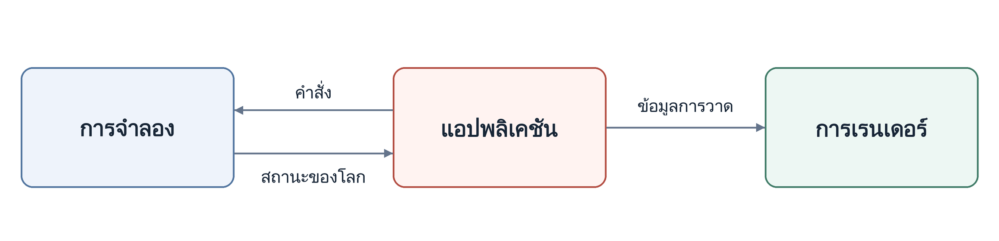

<p align="center" dir="ltr">
  <a href="README.sv.md" lang="sv">Svenska</a> · <a href="README.zh-CN.md" lang="zh-CN">简体中文</a> · <a href="README.de.md" lang="de">Deutsch</a> · <a href="README.ar.md" lang="ar" dir="rtl">العربية</a> · <a href="README.ru.md" lang="ru">Русский</a> · <strong>ไทย</strong> · <a href="README.tr.md" lang="tr">Türkçe</a> · <a href="README.md" lang="en">English</a>
  &nbsp;&nbsp;
  <a href="https://github.com/YuriPlanet/vera20k/actions/workflows/macos.yml?query=branch%3Amain" title="การทดสอบไลบรารีบน macOS ครั้งล่าสุด (สั่งรันด้วยตนเอง)"></a>
  <a href="https://github.com/YuriPlanet/vera20k/actions/workflows/linux.yml?query=branch%3Amain" title="การทดสอบไลบรารีบน Linux ครั้งล่าสุด (สั่งรันด้วยตนเอง)"></a>
  <a href="https://github.com/YuriPlanet/vera20k/actions/workflows/windows.yml?query=branch%3Amain" title="การทดสอบไลบรารีบน Windows ครั้งล่าสุด (สั่งรันด้วยตนเอง)"></a>
  <a href="https://discord.gg/kmjRUn5m5F"></a>
  
</p>

# VERA20K

VERA20K คือโครงการที่ขับเคลื่อนโดยชุมชนเพื่อเขียนเอนจินเกมต้นฉบับ `gamemd.exe` ขึ้นใหม่
โดยใช้ไฟล์จากเกมต้นฉบับ คุณจึงต้องมี Red Alert 2: Yuri's Revenge ของตัวเอง

VERA20K สร้างโดยเกมเมอร์ เพื่อเกมเมอร์ และเกมเมอร์คือผู้ตัดสินใจขั้นสุดท้ายว่าโครงการจะไปในทิศทางใด


## เป้าหมายของโครงการ

1. คงรูปแบบการเล่น ภาพ และบรรยากาศของ Red Alert 2: Yuri's Revenge ต้นฉบับไว้
2. รองรับการต่อสู้ที่ใหญ่ขึ้น: สูงสุด **30 ผู้เล่น** และ **20,000 ยูนิต** บนแผนที่ขนาด 500×500
3. เพิ่มฟีเจอร์ RTS ที่เป็นที่รู้จัก รวมถึงฟีเจอร์ที่ไม่เคยมีมาก่อน
4. ไคลเอนต์ผู้เล่นหลายคนในตัว

## สถานะปัจจุบัน

**กำลังพัฒนาอย่างต่อเนื่อง**

- **การต่อสู้ภายในเครื่อง:** เล่นได้บน Windows, Linux และ macOS รองรับแผนที่จากเกมต้นฉบับ
  และแผนที่สุ่ม การสร้างฐาน การเก็บทรัพยากร การต่อสู้ และการบันทึก/โหลดเกม
- **แคมเปญ:** เริ่มภารกิจได้แล้ว แต่การรองรับยังไม่สมบูรณ์
- **AI:** บางส่วนของ AI ต้นฉบับสามารถสร้างฐานและโจมตีตามสคริปต์ได้แล้ว
- **งานที่กำลังดำเนินการ:** ความแม่นยำของพฤติกรรมในเกม ภาพ และประสิทธิภาพ
- **โหมดผู้เล่นหลายคน:** ยังไม่สามารถเล่นผ่านเครือข่ายได้
- **ขนาดการต่อสู้:** ยังไม่มีการสาธิตการต่อสู้ที่มีผู้เล่น 30 คนและยูนิต 20,000 ตัว

## สถาปัตยกรรม

เอนจินแบ่งเป็นสามส่วนหลัก:

- **การจำลอง:** ดูแลสถานะและตรรกะของเกม
- **การเรนเดอร์:** ไปป์ไลน์การเรนเดอร์ด้วย GPU ที่สร้างขึ้นใหม่ทั้งหมด ใช้ทรัพยากรเกมต้นฉบับ
  และสร้างขึ้นเพื่อคงรูปลักษณ์เดิมไว้
- **แอปพลิเคชัน:** จัดการอินพุต เมนู เสียง และการทำงานร่วมกับแพลตฟอร์ม พร้อมเชื่อมระบบต่าง ๆ เข้าด้วยกัน

การแยกส่วนนี้ช่วยให้ผลการจำลองเกมคงที่เมื่อเริ่มจากสถานะและอินพุตเดียวกัน

ลูกศรแสดงการไหลของข้อมูล:



## บิลด์และรัน

สิ่งที่ต้องมี:

- **เกม:** Red Alert 2: Yuri's Revenge
- **Rust และ Git:** [Rust](https://rustup.rs/) เวอร์ชันเสถียรล่าสุดที่ติดตั้งผ่าน rustup และ [Git](https://git-scm.com/)
- **เครื่องมือบิลด์:** บน Windows ใช้ C++ build tools ของ Visual Studio ซึ่งตัวติดตั้ง Rust จะเสนอให้ติดตั้ง
  บน macOS รัน `xcode-select --install` บน Debian และ Ubuntu รัน `sudo apt install build-essential libasound2-dev pkg-config`
- **กราฟิก:** GPU ที่รองรับ Vulkan, DirectX 12 หรือ Metal

มีการเล่น VERA20K บน Windows, Linux และ macOS แล้ว

```sh
git clone https://github.com/YuriPlanet/vera20k.git
cd vera20k
cp config.toml.example config.toml
# ก่อนรัน ให้แก้ไข config.toml และตั้งค่า ra2_dir เป็นโฟลเดอร์เกมของคุณ:
cargo run --release --bin vera20k
```

## วิธีทำงานของเรา

โค้ดส่วนใหญ่เขียนโดยเอเจนต์ AI ซึ่งใช้ Ghidra ศึกษาเอนจินต้นฉบับ
แล้วนำพฤติกรรมของมันมาเขียนใน Rust และตรวจสอบด้วย[เครื่องมือเปรียบเทียบ](tools/native_oracle.md)
และการทดลองเล่น เอเจนต์ทำตาม [AGENTS.md](AGENTS.md)

## การปรับแต่ง

ฟีเจอร์เสริม (เช่น ฟีเจอร์จาก Ares) ควรตั้งค่าได้ผ่านไฟล์ INI
และมีตัวเลือกเปิดหรือปิดในไคลเอนต์ตามความเหมาะสม

## ร่วมพัฒนา

ยินดีรับความช่วยเหลือ คุณจะเขียนโค้ด รีแฟกเตอร์เอนจิน ทดสอบเกม เสนอไอเดีย หรือเล่นเทียบกับเกมต้นฉบับ
แล้วบอกเราว่าตรงไหนรู้สึกผิดไปก็ได้ เปิด PR มาได้เลย ที่เหลือเราจัดการเอง
การพูดคุยอยู่ใน [Discord](https://discord.gg/kmjRUn5m5F) และในกลุ่ม QQ (1097193563)

## สนับสนุนโครงการ

<a href="https://paypal.me/vera20k"></a>

เงินบริจาคทั้งหมดที่ได้รับจะจัดสรรให้
ผู้มีส่วนร่วมตาม[บัญชีบันทึกผลงาน TIBTRE](https://github.com/YuriPlanet/tibtre-ledger)

ผู้มีส่วนร่วมรับเงินได้ผ่าน:

<p>     </p>

## เครดิตและข้อกฎหมาย

ขอบคุณ OpenRA, XCC Mixer, วิกิ ModEnc, Project Perfect Mod, EA ที่เผยแพร่ซอร์สโค้ดของ
Command & Conquer และ Red Alert ภายใต้ GPL, World-Altering Editor, Final Alert, YRpp, Ares, Phobos
และอีกหลายโครงการ

เผยแพร่ภายใต้สัญญาอนุญาต [GPLv3](LICENSE-GPL) ที่เก็บโค้ดนี้ไม่มีไฟล์เกม
Command & Conquer และ Red Alert เป็นเครื่องหมายการค้าของ Electronic Arts Inc.
ภาพหน้าจอแสดงงานภาพจากเกมที่เป็นของ Electronic Arts
VERA20K ไม่มีความเกี่ยวข้องกับ Electronic Arts และไม่ได้รับการรับรองจาก Electronic Arts

แปลจาก [README.md](README.md) โปรดปรับปรุงให้ตรงกับฉบับภาษาอังกฤษเสมอ
